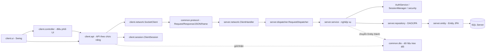

# Giải thích các class và mối liên hệ trong project

Tài liệu này mô tả mã nguồn hiện tại của ứng dụng quản lý cửa hàng quần áo, đặt tại `src/main/java`. Ứng dụng được chia thành client Swing, giao tiếp TCP Socket, server, nghiệp vụ, repository/JPA và các DTO dùng chung. Tên class trong tài liệu được giữ nguyên như trong source để dễ tìm bằng Eclipse (`Ctrl+Shift+T`).

## 1. Toàn cảnh kiến trúc



Mỗi phía có trách nhiệm riêng:

- `client.ui` hiển thị và nhận thao tác; không kết nối trực tiếp SQL Server.
- `client.api` đóng gói yêu cầu theo chức năng, gửi qua `SocketClient`, chuyển JSON phản hồi thành DTO.
- `common.protocol` định nghĩa các action và cấu trúc gói tin chung giữa hai tiến trình.
- `server.network` nhận kết nối; `RequestDispatcher` định tuyến action đến service tương ứng.
- `server.service` kiểm tra quyền, dữ liệu đầu vào, quy tắc nghiệp vụ và transaction.
- `server.repository` thực hiện truy vấn/lưu dữ liệu bằng JPA; `server.entity` ánh xạ bảng SQL.
- `common.dto` là dữ liệu trao đổi an toàn qua mạng. Entity JPA không được gửi trực tiếp cho client.

## 2. Luồng kết nối giữa các class

### Khởi động client và đăng nhập

1. `ClientMain.main()` đọc cấu hình bằng `ClientConfig`, tạo `SocketClient`, `ClientSession`, `AuthApi`, rồi mở `DangNhapForm` trên Swing Event Dispatch Thread.
2. `DangNhapForm` chứa/gắn `DangNhapPanel`; thao tác đăng nhập đi qua `DangNhapController` hoặc `AuthApi` tùy luồng giao diện.
3. `AuthApi.login()` tạo `LoginRequest` và gọi `SocketClient.send(Action.DANG_NHAP, ...)`.
4. `SocketClient` tạo `Request`, mã hóa bằng `JsonCodec`, đóng gói bằng `FrameIO`, gửi qua TCP và xác thực `requestId` trong phản hồi.
5. `SocketServer` chấp nhận socket, giao cho `ClientHandler`; handler giải mã gói tin rồi gọi `RequestDispatcher.dispatch()`.
6. Dispatcher gọi `AuthService.login()`. Service tra `TaiKhoan`/`NhanVien`, xác minh mật khẩu qua `Pbkdf2PasswordHasher`, tạo phiên trong `SessionManager`, rồi trả `LoginResponse`.
7. `AuthApi` lưu response trong `ClientSession`; giao diện mở `MainForm`, dùng `MainShellPanel` để điều hướng.

### Lập và thanh toán hóa đơn

```text
BanHangPanel
  -> BanHangController / HoaDonApi
  -> SocketClient + Action + DTO
  -> ClientHandler -> RequestDispatcher
  -> HoaDonService
  -> JpaHoaDonDao / JpaBienTheDao / các entity JPA
  -> SQL Server
```

`HoaDonService` là nơi chịu trách nhiệm chính: tạo nháp, thêm/sửa/bỏ mặt hàng, tính lại tiền, kiểm tra khuyến mãi/thuế và tồn kho, thanh toán hoặc hủy nháp. `HoaDonPanel` dùng `HoaDonApi.search()` để liệt kê hóa đơn và `detail()` để lấy chi tiết; màn này chỉ đọc, không sửa hóa đơn.

### Tìm sản phẩm và gợi ý khi bán hàng

`BanHangPanel` gọi `SanPhamApi.search()` với `SanPhamSearchRequest`. Yêu cầu đi đến `SanPhamService.search()` rồi `JpaSanPhamDao.search()`. Khi người dùng chọn kết quả, `SanPhamApi.detail()` lấy biến thể và ảnh thông qua `SanPhamService.detail()`, `JpaBienTheDao`, `JpaAnhSanPhamDao`. Client chỉ nhận `SanPhamDTO`, `BienTheDTO`, `AnhSanPhamDTO`.

## 3. Các class khởi động và cấu hình

| Class | Vai trò và quan hệ |
|---|---|
| `client.ClientMain` | Điểm vào ứng dụng desktop; khởi tạo config, socket/session/API và mở màn đăng nhập. |
| `client.config.ClientConfig` | Đọc host/port client từ cấu hình; được `ClientMain` sử dụng. |
| `server.ServerMain` | Điểm vào server; tạo `JpaManager`, service, `RequestDispatcher`, `SocketServer`, quản lý vòng đời server. |
| `server.AccountSetupMain` | Công cụ chạy riêng để tạo tài khoản quản lý đầu tiên; không tham gia luồng chạy thường xuyên. |
| `server.config.ServerConfig` | Đọc host/port lắng nghe của server. |
| `server.config.DatabaseConfig` | Đọc `QUANAO_DB_URL`, `QUANAO_DB_USER`, `QUANAO_DB_PASSWORD` và cấu hình JDBC cho JPA. |
| `server.persistence.JpaManager` | Tạo `EntityManagerFactory`; mỗi lời gọi `transaction(...)` mở EntityManager, bắt đầu/commit hoặc rollback transaction rồi đóng EntityManager. |

## 4. Các class phía client

### 4.1 Giao tiếp mạng và phiên đăng nhập

| Class | Vai trò và liên hệ |
|---|---|
| `client.network.SocketClient` | Quản lý kết nối TCP, tuần tự hóa request/response và đồng bộ gửi một request tại một thời điểm. API client dùng class này. |
| `client.session.ClientSession` | Lưu `LoginResponse`/token trong RAM ở client; token được gửi kèm request. Quyền thực tế vẫn do server kiểm tra. |
| `client.api.ApiException` | Biểu diễn lỗi nghiệp vụ/API trả về; UI bắt lỗi này để hiển thị thông báo. |

### 4.2 API theo chức năng

Các API dùng chung `SocketClient` và `ClientSession`; chúng không truy cập JPA hay SQL trực tiếp.

| Class | Chức năng |
|---|---|
| `AuthApi` | Đăng nhập, đăng xuất, xem hồ sơ, đổi mật khẩu; tạo các API con dùng chung socket/session. |
| `SanPhamApi` | Tra cứu sản phẩm, chi tiết sản phẩm và thao tác quản lý sản phẩm/biến thể/danh mục liên quan. |
| `HoaDonApi` | Tạo hóa đơn, xem/tìm hóa đơn, sửa dòng hàng, thanh toán, hủy nháp và lấy danh sách thuế cho quầy. |
| `ManagementApi` | API dùng chung cho khách hàng, nhân viên, khuyến mãi và thuế (`Kind` xác định nhóm dữ liệu). |
| `KhachHangApi` | API chuyên biệt/ủy quyền cho các thao tác khách hàng. |
| `NhanVienApi` | API chuyên biệt cho thao tác nhân viên/tài khoản. |
| `KhuyenMaiApi` | API chuyên biệt cho khuyến mãi. |
| `ThueApi` | API chuyên biệt cho cấu hình thuế. |
| `ThongKeApi` | Gửi yêu cầu thống kê doanh thu theo thời gian hoặc sản phẩm. |

Một số API chuyên biệt tồn tại song song với `ManagementApi` để gom các thao tác theo miền chức năng. Giao diện hiện có thể dùng trực tiếp `ManagementApi` cho màn quản trị tổng hợp.

### 4.3 Controller phía client

Các controller client là lớp trung gian mỏng giữa màn hình và API, giúp gom lệnh theo nghiệp vụ. Một vài màn hình hiện tại gọi API trực tiếp; vì thế controller không nhất thiết xuất hiện trong mọi đường đi thực tế.

| Class | Vai trò |
|---|---|
| `BanHangController` | Các lệnh tạo/chỉnh sửa/thanh toán hóa đơn cho quầy bán hàng. |
| `HoaDonController` | Nhóm lệnh tra cứu và xem hóa đơn. |
| `SanPhamController` | Tìm kiếm và xem chi tiết sản phẩm. |
| `QuanLySanPhamController` | Thao tác quản trị sản phẩm, danh mục, thương hiệu và biến thể. |
| `BienTheController` | Thao tác biến thể sản phẩm. |
| `LoaiSanPhamController` | Thao tác loại sản phẩm. |
| `ThuongHieuController` | Thao tác thương hiệu. |
| `KhachHangController` | Thao tác khách hàng. |
| `NhanVienController` | Thao tác nhân viên. |
| `KhuyenMaiController` | Thao tác khuyến mãi. |
| `ThongKeController` | Yêu cầu thống kê. |
| `DangNhapController` | Điều phối đăng nhập/đăng xuất. |
| `DoiMatKhauController` | Đổi mật khẩu. |
| `ThongTinCaNhanController` | Lấy thông tin hồ sơ nhân viên. |
| `MainController` | Điều phối thao tác cấp ứng dụng nếu dùng luồng controller tổng. |

### 4.4 Giao diện Swing

`MainForm` giữ các màn hình theo dạng tạo lười (chỉ tạo lần đầu), sau đó dùng lại. `MainShellPanel` là khung điều hướng/sidebar và vùng nội dung. Các `Form` thường là cửa sổ/dialog hoặc lớp ghép giao diện; các `Panel` thường chứa thành phần màn hình.

| Class | Chức năng |
|---|---|
| `DangNhapForm`, `DangNhapPanel` | Cửa sổ và nội dung đăng nhập. |
| `MainForm`, `MainShellPanel` | Cửa sổ chính, menu, phân quyền hiển thị điều hướng và chuyển màn hình. |
| `SanPhamForm`, `SanPhamPanel` | Tra cứu/danh sách sản phẩm. |
| `SanPhamDetailForm`, `SanPhamDetailPanel` | Xem thông tin chi tiết sản phẩm, biến thể và ảnh. |
| `SanPhamEditorPanel` | Biểu mẫu thêm/cập nhật sản phẩm. |
| `QuanLySanPhamPanel` | Màn quản lý sản phẩm và danh mục tổng hợp. |
| `DanhMucPanel`, `LoaiSanPhamForm`, `ThuongHieuForm` | Giao diện danh mục loại sản phẩm/thương hiệu. |
| `BienTheForm`, `BienTheManagementPanel` | Quản lý màu, size, tồn kho và trạng thái biến thể. |
| `ProductImagePanel` | Chọn/hiển thị và quản lý ảnh sản phẩm trong màn chi tiết/chỉnh sửa. |
| `ProductTableSupport` | Tiện ích dùng chung cho bảng sản phẩm. |
| `BanHangForm`, `BanHangPanel` | Quầy bán hàng: chọn thuế/khuyến mãi, tìm sản phẩm, thêm biến thể, tạo nháp và thanh toán. |
| `HoaDonForm`, `HoaDonPanel` | Tra cứu danh sách hóa đơn và mở chi tiết hóa đơn chỉ đọc. |
| `KhachHangForm` | Màn quản lý khách hàng. |
| `NhanVienForm`, `NhanVienProfilePanel` | Quản lý nhân viên và hiển thị hồ sơ. |
| `KhuyenMaiForm` | Quản lý chương trình khuyến mãi. |
| `ThueForm` | Quản lý cấu hình thuế. |
| `ThongKeForm`, `ThongKePanel` | Chọn điều kiện và hiển thị báo cáo doanh thu. |
| `ThongTinCaNhanForm` | Xem hồ sơ người dùng hiện tại. |
| `DoiMatKhauForm`, `DoiMatKhauPanel` | Form và nội dung đổi mật khẩu. |
| `ManagementPanel` | Khung danh sách/quản lý dùng chung cho các loại bản ghi quản trị. |
| `ManagementEditorPanel` | Form chỉnh sửa dùng chung cho màn quản trị. |
| `UiTask` | Chạy tác vụ nền bằng `SwingWorker`, cập nhật UI và xử lý kết quả/lỗi trên EDT. |
| `UiTheme` | Màu sắc, nút, bảng, tiêu đề và định dạng dùng chung cho Swing/FlatLaf. |
| `BrandIcon` | Vẽ biểu tượng thương hiệu THREAD bằng Java2D. |

`client.util.ImageLoader` tải/đọc ảnh từ resource hoặc đường dẫn ảnh sản phẩm và tạo icon/ảnh thu nhỏ cho UI.

## 5. Giao thức và DTO dùng chung

### 5.1 Giao thức Socket

| Class | Vai trò |
|---|---|
| `Action` | Danh sách mã chức năng: đăng nhập, tra cứu, CRUD, lập hóa đơn, thanh toán, thống kê… |
| `Request<T>` | Gói yêu cầu gồm request ID, `Action`, session token và payload. |
| `Response<T>` | Gói phản hồi gồm request ID, trạng thái thành công/lỗi, error code, thông báo và payload. |
| `ErrorCode` | Mã lỗi giao thức/nghiệp vụ như chưa xác thực, sai dữ liệu, xung đột phiên bản, lỗi server. |
| `FrameIO` | Đóng/gỡ khung dữ liệu trên luồng TCP để phía nhận biết ranh giới message. |
| `JsonCodec` | Cấu hình Jackson mapper dùng để chuyển object ↔ JSON, bao gồm kiểu ngày giờ. |

### 5.2 DTO

DTO là object truyền giữa client và server, không phải entity database. Nhóm request thường đi client → server; nhóm response/result thường đi server → client.

| Nhóm | Class | Ý nghĩa |
|---|---|---|
| Tài khoản | `LoginRequest`, `LoginResponse`, `DoiMatKhauRequest`, `TaiKhoanDTO`, `NhanVienAccountDTO` | Thông tin đăng nhập, phản hồi phiên/vai trò, đổi mật khẩu và dữ liệu tài khoản được phép trao đổi. Không gửi password hash. |
| Sản phẩm | `SanPhamSearchRequest`, `SanPhamSearchResult`, `SanPhamDetailRequest`, `SanPhamDetailDTO`, `SanPhamDTO`, `SanPhamSaveRequest` | Điều kiện tìm kiếm, trang kết quả, chi tiết, dữ liệu sản phẩm và request ghi sản phẩm. |
| Biến thể/ảnh | `BienTheDTO`, `AnhSanPhamDTO` | Màu/size/tồn/trạng thái biến thể và metadata/đường dẫn ảnh. |
| Danh mục | `DanhMucSaveRequest`, `LoaiSanPhamDTO`, `ThuongHieuDTO` | Request và dữ liệu loại sản phẩm/thương hiệu. |
| Hóa đơn | `HoaDonCreateRequest`, `HoaDonLineRequest`, `HoaDonVersionRequest`, `HoaDonSearchRequest`, `HoaDonSearchResult`, `HoaDonDTO`, `HoaDonDetailDTO`, `ChiTietHoaDonDTO` | Tạo/sửa/đổi trạng thái, tìm kiếm hóa đơn, dữ liệu phần đầu và chi tiết dòng hàng. `phienBan` hỗ trợ phát hiện cập nhật đồng thời. |
| Quản trị | `ManagementSearchRequest`, `ManagementSearchResult`, `ManagementSaveRequest`, `KhachHangDTO`, `NhanVienDTO`, `KhuyenMaiDTO`, `ThueDTO` | Tra cứu/lưu và kết quả cho các màn quản lý. `ManagementSearchResult.items` chứa JSON node được chuyển về DTO thích hợp ở client. |
| Thống kê | `RevenueRequest`, `RevenueRequest.Group`, `RevenueResult`, `RevenueResult.Row`, `ThongKeDoanhThuDTO` | Bộ lọc báo cáo; `Group` chọn cách nhóm dữ liệu, `Row` là một dòng kết quả, DTO còn lại chứa số liệu doanh thu tổng hợp. |

### 5.3 Enum và tiện ích dùng chung

- `VaiTro`: phân biệt vai trò nhân viên bán hàng và nhân viên quản lý.
- `TrangThaiHoaDon`: trạng thái hóa đơn như nháp, đã thanh toán, đã hủy.
- `InvoiceIds`: tạo mã hóa đơn phía client; server vẫn kiểm tra mã và xử lý lặp an toàn.
- `MoneyUtils`: quy tắc phép tính/làm tròn tiền dùng chung ở nghiệp vụ.
- `PropertiesLoader`: đọc file cấu hình dạng properties.

## 6. Server: mạng, định tuyến và nghiệp vụ

### 6.1 Lớp mạng

| Class | Vai trò và quan hệ |
|---|---|
| `server.network.SocketServer` | Mở cổng TCP, nhận client, quản lý pool worker và vòng đời socket. Tạo một `ClientHandler` cho mỗi kết nối. |
| `server.network.ClientHandler` | Đọc frame, parse JSON thành `Request<JsonNode>`, gọi dispatcher, ghi `Response` trở lại client. |
| `server.dispatcher.RequestDispatcher` | `switch` theo `Action`, đổi payload thành DTO, gọi đúng service và chuẩn hóa lỗi thành `Response`. |

### 6.2 Service nghiệp vụ

Service là nơi kiểm tra quyền và luật nghiệp vụ; các thao tác dữ liệu thường được bọc trong `JpaManager.transaction(...)`.

| Class | Vai trò |
|---|---|
| `AuthService` | Đăng nhập, xác thực session/token, hồ sơ, đổi mật khẩu, đăng xuất; kết nối `TaiKhoanDao`, `SessionManager`, `PasswordHasher`. |
| `SanPhamService` | Tìm sản phẩm, xem chi tiết và chuyển entity thành DTO; dùng các DAO sản phẩm, biến thể, ảnh. |
| `QuanLySanPhamService` | Thêm/cập nhật/ngừng sản phẩm, loại, thương hiệu và biến thể; là phần quản trị được tạo từ `SanPhamService.management()`. |
| `BienTheService` | Xử lý nghiệp vụ cho biến thể sản phẩm khi được gọi độc lập. |
| `LoaiSanPhamService` | Nghiệp vụ loại sản phẩm. |
| `ThuongHieuService` | Nghiệp vụ thương hiệu. |
| `HoaDonService` | Tạo nháp, sửa dòng hàng, tính tổng, tra cứu, xem chi tiết, thanh toán, hủy; xác thực quyền sở hữu, phiên bản, thuế, khuyến mãi và tồn kho. |
| `KhachHangService` | Tìm/thêm/cập nhật/ngừng khách hàng; kiểm soát quyền xem dữ liệu ngừng hoạt động. |
| `NhanVienService` | Tìm/thêm/cập nhật/ngừng nhân viên và tài khoản; áp dụng quyền quản lý. |
| `KhuyenMaiService` | Tìm/lưu/ngừng khuyến mãi, kiểm tra tỷ lệ và khoảng ngày. |
| `ThueService` | Tìm/lưu/ngừng cấu hình thuế; kiểm tra quyền quản lý và dữ liệu tỷ lệ. |
| `ThongKeService` | Tạo báo cáo doanh thu theo thời gian hoặc sản phẩm từ các hóa đơn đủ điều kiện. |
| `ManagementSupport` | Quy tắc dùng chung cho phân trang, kiểm tra request, chuẩn hóa chuỗi, mapping và lỗi của nhóm service quản trị. |
| `SequentialCodeGenerator` | Cấp mã tăng dần theo prefix dựa trên mã lớn nhất trong bảng, rồi giữ bộ đếm trong server để tránh trùng giữa các client trong cùng tiến trình. |
| `BusinessException` | Lỗi nghiệp vụ có `ErrorCode`; dispatcher chuyển thành phản hồi có kiểm soát. |

### 6.3 Xác thực và bảo mật

| Class | Vai trò |
|---|---|
| `SessionManager` | Tạo token ngẫu nhiên, lưu phiên trong bộ nhớ, kiểm tra hết hạn/thu hồi phiên. Server tra token này thay vì tin vai trò gửi từ client. |
| `PasswordHasher` | Hợp đồng băm/xác minh mật khẩu. |
| `Pbkdf2PasswordHasher` | Cài đặt PBKDF2-HMAC-SHA256 có salt và số vòng lặp; lưu chuỗi hash có metadata, không lưu mật khẩu thô. |
| `PermissionChecker` | Tiện ích kiểm tra đăng nhập/vai trò; các service vẫn phải xác thực session thật ở server. |

## 7. Repository và Entity JPA

### 7.1 Repository/DAO

Interface định nghĩa thao tác dữ liệu; `Jpa...Dao` thực hiện bằng `EntityManager`. `JpaGenericDao<T, ID>` cung cấp thao tác tổng quát để các DAO cụ thể kế thừa.

| Interface / class | Phạm vi dữ liệu |
|---|---|
| `GenericDao`, `JpaGenericDao` | Tìm theo ID, lưu/xóa và thao tác tổng quát. |
| `SanPhamDao`, `JpaSanPhamDao` | Tìm/lọc/đếm sản phẩm, tổng tồn kho. |
| `BienTheDao`, `JpaBienTheDao` | Tìm biến thể theo sản phẩm và dữ liệu tồn. |
| `AnhSanPhamDao`, `JpaAnhSanPhamDao` | Truy vấn ảnh sản phẩm. |
| `HoaDonDao`, `JpaHoaDonDao` | Tìm kiếm hóa đơn, chi tiết, khóa/cập nhật phục vụ luồng hóa đơn. |
| `ChiTietHoaDonDao`, `JpaChiTietHoaDonDao` | Truy vấn dòng chi tiết hóa đơn. |
| `TaiKhoanDao`, `JpaTaiKhoanDao` | Truy vấn tài khoản đăng nhập. |
| `LoaiSanPhamDao`, `JpaLoaiSanPhamDao` | Truy vấn loại sản phẩm. |
| `ThuongHieuDao`, `JpaThuongHieuDao` | Truy vấn thương hiệu. |
| `KhachHangDao` | Hợp đồng truy cập dữ liệu khách hàng. |
| `NhanVienDao` | Hợp đồng truy cập dữ liệu nhân viên. |
| `KhuyenMaiDao` | Hợp đồng truy cập dữ liệu khuyến mãi. |
| `ThueDao` | Hợp đồng truy cập dữ liệu thuế. |
| `ManagementRepository<T>` | Repository dùng chung cho danh sách quản trị có mã, tên, lọc, đếm và phân trang. |

Service tạo DAO với `EntityManager` bên trong transaction; DAO không tự commit. Cách này giữ toàn bộ thay đổi của một nghiệp vụ trong một transaction nhất quán.

### 7.2 Entity và quan hệ dữ liệu

| Entity | Ánh xạ/quan hệ chính |
|---|---|
| `SanPham` | Bảng sản phẩm; tham chiếu `LoaiSanPham` và `ThuongHieu`. |
| `BienThe` | Thuộc một `SanPham`; lưu màu, size, số lượng tồn, trạng thái và `@Version`. |
| `AnhSanPham` | Thuộc một `SanPham`; lưu màu, đường dẫn, thứ tự và cờ ảnh chính. |
| `LoaiSanPham` | Danh mục loại sản phẩm. |
| `ThuongHieu` | Danh mục thương hiệu. |
| `HoaDon` | Thuộc một `NhanVien`, một `Thue`; có thể gắn `KhachHang` và `KhuyenMai`; lưu snapshot tỷ lệ/tiền và `@Version`. |
| `ChiTietHoaDon` | Mỗi dòng tham chiếu một `HoaDon` và một `BienThe`; lưu số lượng, đơn giá, thành tiền. |
| `NhanVien` | Hồ sơ nhân viên được hóa đơn tham chiếu. |
| `TaiKhoan` | Gắn một-một với `NhanVien`; chứa username, password hash, vai trò và trạng thái. |
| `KhachHang` | Hồ sơ khách hàng; hóa đơn có thể tham chiếu. |
| `KhuyenMai` | Tỷ lệ giảm và ngày hiệu lực; hóa đơn có thể tham chiếu và lưu snapshot giảm giá. |
| `Thue` | Cấu hình tỷ lệ thuế; hóa đơn bắt buộc tham chiếu và lưu snapshot tỷ lệ thuế. |

Quan hệ khái quát:

```text
LoaiSanPham 1 ── * SanPham * ── 1 ThuongHieu
                         │
                         ├── 1 ── * BienThe ── * ChiTietHoaDon * ── 1 HoaDon
                         └── 1 ── * AnhSanPham

NhanVien 1 ── 1 TaiKhoan
NhanVien 1 ── * HoaDon * ── 0..1 KhachHang
Thue 1 ── * HoaDon
KhuyenMai 1 ── * HoaDon (mỗi hóa đơn có thể không chọn khuyến mãi)
```

## 8. Các quan hệ cần nhớ khi đọc code

1. **UI không thao tác Entity.** UI làm việc với API/DTO; chỉ server service và repository dùng Entity JPA.
2. **API không tự quyết định quyền.** Client gửi token; service gọi `AuthService`/`SessionManager` để xác thực và kiểm tra vai trò.
3. **Dispatcher là điểm nối của server.** Muốn biết một nút UI gọi hành động server nào, lần theo `Action` từ API đến `RequestDispatcher`.
4. **Service sở hữu transaction.** DAO chỉ truy vấn/cập nhật trong `EntityManager` đang được `JpaManager` mở.
5. **Entity ↔ DTO là ranh giới mạng.** Service tạo DTO để tránh lộ entity, quan hệ lazy hoặc trường nhạy cảm như password hash.
6. **`@Version` xử lý cập nhật đồng thời.** `HoaDon.phienBan` và `BienThe.phienBan` giúp phát hiện trường hợp dữ liệu đã đổi kể từ lúc client tải về.
7. **Các class có tên `Form`/`Panel` không đồng nghĩa tất cả cùng một kiểu cửa sổ.** Hãy xem constructor và nơi được gọi trong `MainForm` để biết class đó là cửa sổ độc lập, dialog hay một view được nhúng.

## 9. Gợi ý đọc code theo tính năng

- Đăng nhập: `DangNhapPanel` → `AuthApi` → `SocketClient` → `RequestDispatcher` → `AuthService` → `TaiKhoanDao`/`SessionManager`.
- Danh sách sản phẩm: `SanPhamPanel` → `SanPhamApi` → `SanPhamService` → `JpaSanPhamDao` → `SanPham`.
- Tạo/thanh toán hóa đơn: `BanHangPanel` → `BanHangController`/`HoaDonApi` → `RequestDispatcher` → `HoaDonService` → `JpaHoaDonDao`, `JpaChiTietHoaDonDao`, `JpaBienTheDao` → Entity.
- Lịch sử hóa đơn: `HoaDonPanel` → `HoaDonApi.search/detail()` → `HoaDonService` → DAO → `HoaDonSearchResult`/`HoaDonDetailDTO`.
- Quản lý khuyến mãi/thuế/nhân viên/khách hàng: Form tương ứng → `ManagementApi` → dispatcher → service quản trị tương ứng → `ManagementRepository`/Entity.
- Thống kê: `ThongKePanel` → `ThongKeApi` hoặc `ManagementApi.report()` → `ThongKeService` → truy vấn hóa đơn → `RevenueResult`.

## 10. Một số khác biệt giữa tên class và cấu trúc thực thi

Project có một số controller/API chuyên biệt được tạo sẵn để tách trách nhiệm, nhưng một số màn hình đang gọi API tổng hợp hoặc API trực tiếp. Vì vậy, khi lần theo một chức năng cụ thể, nên tìm nơi gọi class bằng `Ctrl+Shift+G` (Eclipse) hoặc `Ctrl+H`, sau đó theo `Action` đến dispatcher; không nên chỉ dựa vào tên class để kết luận class đó đang được sử dụng.
