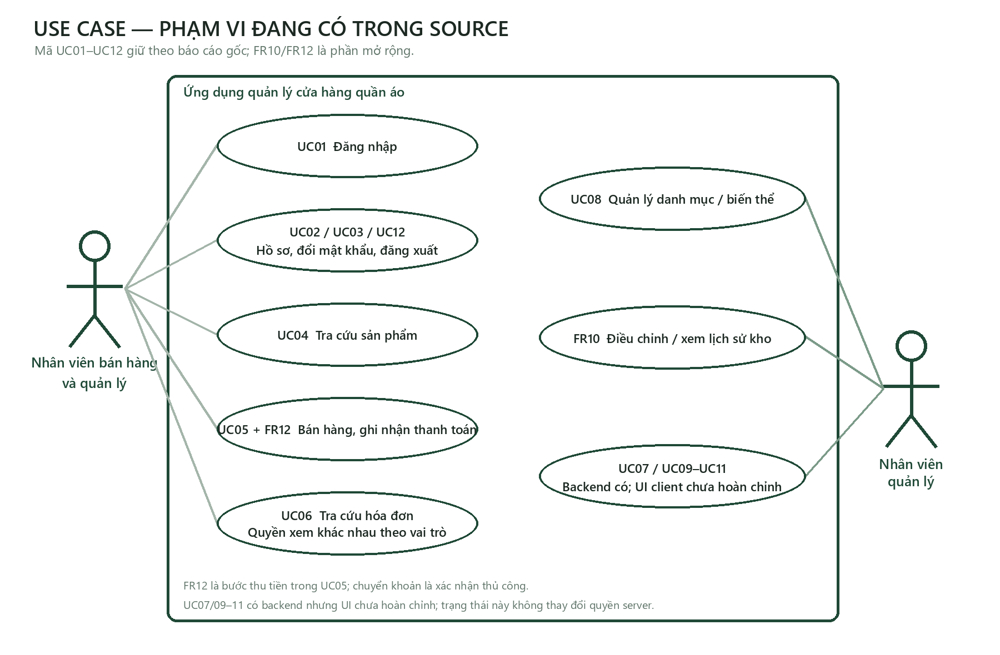
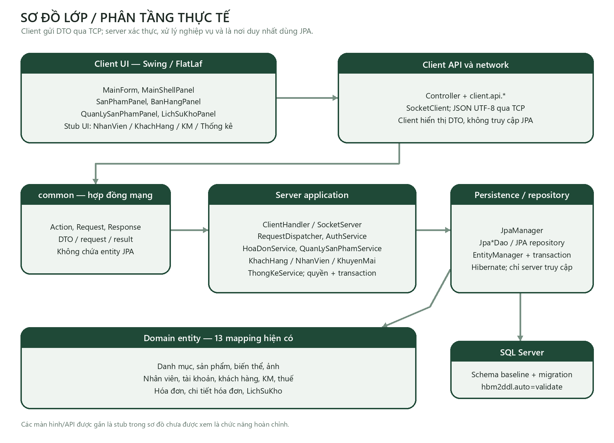
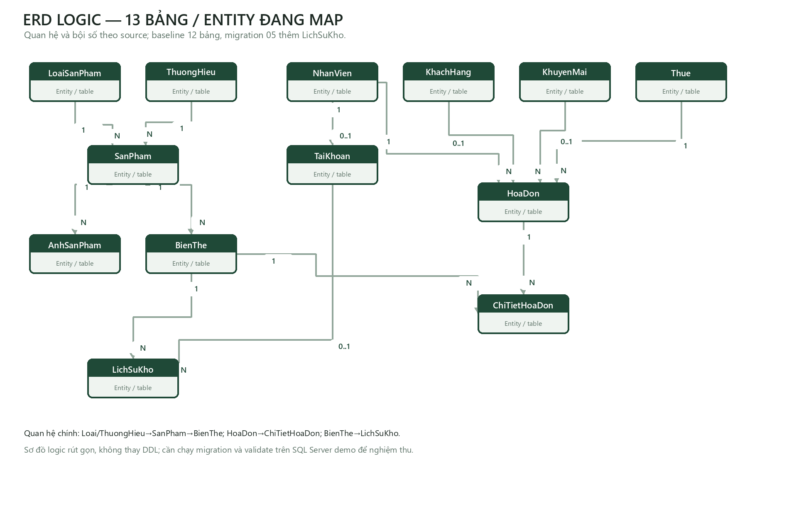

# Báo cáo hiện trạng và hoàn thiện ứng dụng quản lý cửa hàng quần áo

**Phiên bản S27 | Ngày cập nhật: 11/10/2026**  
**Nhóm 11 | Môn Lập trình phân tán với công nghệ Java**

## Phạm vi và kết luận

Bản báo cáo này cập nhật bốn chương theo source hiện có, kết quả kiểm thử vừa chạy và giới hạn môi trường đã biết. Ba tài liệu Chương 1–3 ban đầu được giữ nguyên; bản S27 là tài liệu thay thế có kiểm soát để đọc cùng dự án. Các yêu cầu FR10–FR15 là phần mở rộng của kế hoạch hoàn thiện, không phải yêu cầu nguyên thủy của đề bài.

Dự án đã có luồng đăng nhập, tra cứu và quản lý sản phẩm/biến thể, lập nháp, thanh toán, tra cứu hóa đơn và lịch sử kho. Backend cho khách hàng, nhân viên/tài khoản, khuyến mãi và thống kê có action, service, repository và kiểm thử, nhưng các API/màn hình Swing tương ứng còn rỗng hoặc chưa được nối vào điều hướng. FR11, FR13, FR14 và FR15 chưa được triển khai. Vì vậy source hiện tại chưa đạt nghiệm thu đầy đủ FR01–FR15, dù bộ kiểm thử H2/Socket đạt.

## Mục lục

1. Chương 1 — Giới thiệu đề tài và phạm vi thực tế
2. Chương 2 — Phân tích yêu cầu, quyền, kiến trúc và dữ liệu
3. Chương 3 — Môi trường, màn hình và kiểm thử
4. Chương 4 — Kết quả, giới hạn và kịch bản demo
5. Tài liệu tham khảo

# Chương 1 — Giới thiệu đề tài và phạm vi thực tế

## 1.1 Bối cảnh

Cửa hàng quần áo cần quản lý sản phẩm theo loại và thương hiệu, đồng thời theo dõi tồn riêng cho từng biến thể màu sắc và kích cỡ. Nhân viên cần tra cứu hàng, lập hóa đơn, nhận thanh toán và biết tồn kho thay đổi do đâu. Người quản lý cần phân quyền, quản lý danh mục và theo dõi số liệu mà không làm thay đổi lịch sử giao dịch đã hoàn tất.

Ứng dụng sử dụng mô hình client–server trong mạng TCP. Client hiển thị giao diện Swing; server xác thực phiên, kiểm tra quyền, thực hiện nghiệp vụ và truy cập SQL Server qua JPA/Hibernate. Client gửi DTO qua giao thức JSON có đóng khung TCP; JPA chỉ được dùng trong server.

## 1.2 Mục tiêu

- Duy trì kiến trúc Java Swing/FlatLaf, TCP Socket, JPA/Hibernate và SQL Server.
- Quản lý danh mục sản phẩm, biến thể và số lượng tồn theo từng biến thể.
- Tạo và thanh toán hóa đơn với tiền do server tính, giao dịch bán và trừ kho nguyên tử.
- Bảo vệ chức năng theo vai trò nhân viên bán hàng và nhân viên quản lý.
- Lưu thời điểm thanh toán, dữ liệu chứng từ cần thiết và lịch sử biến động tồn cho giao dịch mới.
- Cập nhật tài liệu theo đúng phần đã có trong source; không xem lớp rỗng hoặc nút chưa nối là chức năng hoàn chỉnh.

## 1.3 Phạm vi yêu cầu

FR01–FR09 là các yêu cầu nghiệp vụ ban đầu: tài khoản, khách hàng, sản phẩm, biến thể/tồn kho, bán hàng, hóa đơn, nhân viên/tài khoản, khuyến mãi và thống kê. FR10–FR15 được bổ sung trong kế hoạch hoàn thiện gồm lịch sử kho, nhà cung cấp/phiếu nhập, thu tiền tại quầy, in/xuất chứng từ, cảnh báo tồn/dashboard, nhật ký quản trị/đặt lại mật khẩu. FR16 trả hàng/hoàn tiền chưa thuộc phạm vi S27 và chỉ được thực hiện khi có prompt R00 trở đi.

Bản source hiện phục vụ một cửa hàng, chưa có thương mại điện tử, giao hàng, tích hợp ngân hàng, nhiều chi nhánh hay hóa đơn điện tử pháp lý. Một số yêu cầu trong phạm vi vẫn chưa được nối đầu cuối; trạng thái chi tiết nằm ở ma trận Chương 2.

## 1.4 Tác nhân và quy trình chính

| Tác nhân | Quyền và trách nhiệm hiện có |
| --- | --- |
| Nhân viên bán hàng | Đăng nhập, xem hồ sơ cá nhân, đổi mật khẩu, tra cứu sản phẩm, thao tác hóa đơn của mình và thanh toán. Server kiểm tra quyền và chủ sở hữu hóa đơn. |
| Nhân viên quản lý | Có quyền bán hàng cùng các quyền quản trị được triển khai ở server: quản lý danh mục, nhân viên/tài khoản, khách hàng, khuyến mãi, thống kê và lịch sử kho. Các màn hình quản trị chưa hoàn chỉnh đồng đều. |
| Server | Xác thực token, kiểm tra quyền, trạng thái và phiên bản; tính tiền; quản lý transaction; truy cập dữ liệu bằng JPA. |
| SQL Server | Lưu dữ liệu bền vững theo schema đã định nghĩa. Chưa có bằng chứng nghiệm thu trên một SQL Server demo trong lần cập nhật này. |

Luồng bán hàng hiện có bắt đầu bằng tra cứu sản phẩm và chọn biến thể. Nhân viên tạo hóa đơn nháp, thêm/sửa/bỏ dòng và kiểm tra tổng. Nháp không giữ chỗ tồn. Khi thanh toán, server kiểm tra lại trạng thái và tổng đã được xác nhận, ghi thông tin thanh toán, lưu snapshot, trừ tồn và ghi ledger trong cùng transaction. Nếu có lỗi, giao dịch bị rollback; phản hồi mất không đồng nghĩa với việc được gửi lại lệnh ghi mù.

## 1.5 Quy tắc nghiệp vụ đã thể hiện trong source

- Số lượng dòng hóa đơn là số nguyên dương. Giá và các khoản tiền được tính bằng `BigDecimal` ở server.
- Giá dòng được chốt khi thêm vào nháp. Hóa đơn nháp không trừ/giữ tồn; thanh toán mới trừ kho một lần.
- Hóa đơn đã thanh toán không được sửa hoặc hủy theo luồng nháp. Hủy nháp không hoàn kho vì nháp chưa trừ kho.
- Server kiểm tra lại hàng, trạng thái, tồn, khuyến mãi và tổng ở thời điểm thanh toán. Nếu số tổng không còn khớp bản đã xác nhận, yêu cầu bị từ chối để người dùng tải lại và xem tổng mới.
- Tổng được tính theo `tạm tính − giảm + thuế`; thuế tính trên giá trị sau giảm và các khoản được làm tròn đến hai chữ số theo quy tắc đang có.
- Khách hàng có thể để trống cho khách vãng lai. Màn hình bán hàng có ô nhập mã khách/mã khuyến mãi, nhưng chưa có tìm kiếm/chọn/tạo hồ sơ từ form riêng.
- Thanh toán tiền mặt ghi tiền khách đưa và tiền thừa do server tính. Chuyển khoản là xác nhận thủ công của nhân viên, không phải xác minh từ ngân hàng.
- Giao dịch mới ghi `ngayThanhToan` theo đồng hồ server và múi giờ nghiệp vụ `Asia/Ho_Chi_Minh`; snapshot chỉ giữ tên hiển thị cần cho chứng từ. Dữ liệu cũ thiếu timestamp/snapshot không được suy đoán.
- Các thay đổi tồn mới do bán, khởi tạo biến thể và điều chỉnh tồn được ghi vào ledger cùng transaction. Tồn trước khi chuyển đổi chỉ được ghi thành mốc mở đầu, không dựng ngược lịch sử.

## 1.6 Công nghệ thực tế

| Thành phần | Đang dùng trong dự án |
| --- | --- |
| Ngôn ngữ và giao diện | Java; Swing; FlatLaf 3.7 |
| Giao tiếp | `Socket`/`ServerSocket` TCP; JSON UTF-8; DTO trong `common`; frame độ dài có giới hạn |
| Lưu trữ | SQL Server qua Microsoft JDBC Driver 13.2.1; cấu hình Hibernate giữ `hbm2ddl.auto=validate` |
| ORM | JPA `javax.persistence` 2.2 với Hibernate ORM 5.6.15.Final |
| Build | Maven; compiler phát bytecode Java 8 (`release=8`) |
| Test | JUnit 4.13.2, H2 2.1.214 trong bộ nhớ; test tích hợp gọi JPA và Socket |

# Chương 2 — Phân tích yêu cầu, quyền, kiến trúc và dữ liệu

## 2.1 Ma trận FR01–FR15 theo source hiện tại

| FR | Backend và action/API | Client UI hiện có | Test/evidence và trạng thái thật |
| --- | --- | --- | --- |
| FR01 Tài khoản | `DANG_NHAP`, `DANG_XUAT`, `XEM_THONG_TIN_CA_NHAN`, `DOI_MAT_KHAU`; `AuthService`, `SessionManager` | Đăng nhập, hồ sơ, đổi mật khẩu, đăng xuất | Có test JPA/Socket/quyền/session. **Đã có đầu cuối** cho phạm vi hiện tại. |
| FR02 Khách hàng | CRUD/trạng thái/tìm kiếm trong `KhachHangService`, DAO và dispatcher | `KhachHangApi`/`KhachHangForm` là lớp rỗng; chưa có luồng chọn/tạo khách trong bán hàng | `KhachHangManagementIntegrationTest` chạy H2/Socket. **Backend có; UI chưa làm, chưa đạt đầu cuối.** |
| FR03 Sản phẩm | Action tra cứu, chi tiết, thêm, sửa, ngừng kinh doanh; service/repository JPA | Tra cứu và quản lý danh mục/sản phẩm | Có test tích hợp và UI headless. **Đã có đầu cuối** cho chức năng đã nối. |
| FR04 Biến thể/tồn | Tra cứu/thêm/sửa biến thể; version và kiểm tra tổ hợp duy nhất; điều chỉnh số tồn nối với FR10 | Quản lý biến thể và tồn trong màn hình danh mục | Test danh mục, optimistic version, rollback/ledger. **Đã có đầu cuối** trong phạm vi hiện tại. |
| FR05 Bán hàng | `LAP_HOA_DON`, `THEM_CHI_TIET_HOA_DON`, `CAP_NHAT_SO_LUONG`, `BO_MAT_HANG`, `THANH_TOAN_HOA_DON`, `HUY_HOA_DON_NHAP` | `BanHangPanel`: nhập mã KH/KM thủ công; nháp, dòng hàng, tổng, thanh toán tiền mặt/chuyển khoản | `InvoiceIntegrationTest` và `InvoiceUiTest`. **Luồng core có; chưa tìm/chọn khách/KM từ danh sách. Khi tỷ lệ thuế/KM thay đổi, hiện phải hủy nháp và lập lại; chưa đạt hợp đồng preview/cập nhật/xác nhận tổng S10.** |
| FR06 Hóa đơn | `TRA_CUU_HOA_DON`, `XEM_CHI_TIET_HOA_DON`; lọc theo quyền và trạng thái | Danh sách, phân trang, mở và xem chi tiết trong màn hình bán hàng | Test filter, phân trang, owner/manager và detail. **Đã có đầu cuối** cho xem/tra cứu. |
| FR07 Nhân viên/tài khoản | Tìm/xem/thêm/sửa/trạng thái nhân viên; tạo/khóa/mở khóa/đổi vai trò tài khoản | `NhanVienApi`, controller và form còn là lớp rỗng; sidebar hiện “Sắp có” | `NhanVienManagementIntegrationTest` chạy backend H2/Socket. **Backend có; UI chưa làm.** |
| FR08 Khuyến mãi | Tìm/xem/thêm/sửa/ngừng/kích hoạt; server kiểm tra hiệu lực | `KhuyenMaiApi`, controller/form rỗng; chưa có thao tác chọn trong giao diện bán hàng | `KhuyenMaiManagementIntegrationTest` và test invoice expiry. **Backend có; UI/liên kết bán hàng thiếu.** |
| FR09 Thống kê | Action theo thời gian/sản phẩm; `ThongKeService`/DAO; chỉ quản lý | API/controller/form là lớp rỗng; sidebar hiện “Sắp có” | `ThongKeIntegrationTest` chạy H2/Socket. **Backend có; UI chưa làm.** |
| FR10 Lịch sử kho | `TRA_CUU_LICH_SU_KHO`, `DIEU_CHINH_TON_KHO`; ledger ghi cùng transaction | `LichSuKhoPanel`; quản lý tra cứu và điều chỉnh có lý do/version | Test rollback, operationId, version, quyền và lọc. **Đã có đầu cuối** trên H2/Socket. |
| FR11 NCC/phiếu nhập | Không có entity/service/action/repository/migration NCC hoặc phiếu nhập | Không có màn hình | Chưa có test nghiệp vụ nhập hàng. **Chưa triển khai.** |
| FR12 Thu tiền tại quầy | Các trường/enum thanh toán trong `HoaDon`, DTO, dispatcher và migration 06 | Dialog chọn tiền mặt hoặc xác nhận chuyển khoản thủ công trong `BanHangPanel` | Test thiếu/đủ/thừa, miền tiền, tổng cũ, retry và rollback. **Đã có trong code; SQL Server chưa xác minh.** |
| FR13 In/PDF/CSV | Không có action hoặc module export chứng từ/thống kê | Không có nút/chức năng in hoặc xuất file | Chưa có test. **Chưa triển khai.** |
| FR14 Cảnh báo tồn/dashboard | Không có ngưỡng tồn hay API tổng hợp dashboard | Tổng quan hiện là trang tĩnh; không có cảnh báo/dashboard dữ liệu | Chưa có test cho ngưỡng/summary. **Chưa triển khai.** |
| FR15 Audit/đặt lại mật khẩu | Không có entity/bảng/action audit hoặc reset quản trị | Không có màn hình | Chưa có test. **Chưa triển khai.** |

Các chức năng chưa hoàn chỉnh được giữ trong bảng hiện trạng và tiêu chí nghiệm thu; báo cáo không chuyển FR01–FR09 còn thiếu sang mục “hướng phát triển” để xem như đã hoàn thành.

Action phía server hiện có cho nhóm backend-only là: FR02 `TRA_CUU_KHACH_HANG`,
`XEM_CHI_TIET_KHACH_HANG`, `THEM_KHACH_HANG`, `CAP_NHAT_KHACH_HANG`,
`NGUNG_HOAT_DONG_KHACH_HANG`, `KICH_HOAT_KHACH_HANG`; FR07 `TRA_CUU_NHAN_VIEN`,
`XEM_CHI_TIET_NHAN_VIEN`, `THEM_NHAN_VIEN`, `CAP_NHAT_NHAN_VIEN`,
`NGUNG_HOAT_DONG_NHAN_VIEN`, `KICH_HOAT_NHAN_VIEN`, `TAO_TAI_KHOAN`, `KHOA_TAI_KHOAN`,
`MO_KHOA_TAI_KHOAN`, `CAP_NHAT_VAI_TRO_TAI_KHOAN`; FR08 `TRA_CUU_KHUYEN_MAI`,
`XEM_CHI_TIET_KHUYEN_MAI`, `THEM_KHUYEN_MAI`, `CAP_NHAT_KHUYEN_MAI`,
`NGUNG_HOAT_DONG_KHUYEN_MAI`, `KICH_HOAT_KHUYEN_MAI`; FR09
`THONG_KE_DOANH_THU_THEO_THOI_GIAN`, `THONG_KE_DOANH_THU_THEO_SAN_PHAM`. Việc action
tồn tại không thay thế API, controller và UI client chưa hoàn thiện.

## 2.2 Vai trò và use case

| Use case | Nội dung | Quyền theo server | Tình trạng |
| --- | --- | --- | --- |
| UC01 | Đăng nhập | Nhân viên bán hàng, quản lý | Client/server hoạt động; test xác thực và trạng thái tài khoản. |
| UC02 | Xem thông tin cá nhân | Nhân viên bán hàng, quản lý | Gắn với token; client không tự chọn mã nhân viên. |
| UC03 | Đổi mật khẩu | Nhân viên bán hàng, quản lý | Xác minh mật khẩu hiện tại và thu hồi phiên theo cơ chế hiện có. |
| UC04 | Tra cứu sản phẩm | Nhân viên bán hàng, quản lý | Tìm kiếm, phân trang và xem biến thể. |
| UC05 | Lập và thanh toán hóa đơn | Nhân viên bán hàng; quản lý theo quyền | Luồng core có; khách hàng/khuyến mãi chưa nối UI. |
| UC06 | Tra cứu/xem hóa đơn | Nhân viên chỉ xem hóa đơn của mình; quản lý xem toàn bộ | Có tìm kiếm, phân trang và chi tiết. |
| UC07 | Quản lý khách hàng | Backend hiện có quyền theo service | Chưa có UI/API client hoàn chỉnh. |
| UC08 | Quản lý sản phẩm/biến thể | Quản lý sửa; cả hai vai trò tra cứu | UI và server đã nối cho danh mục/biến thể. |
| UC09 | Quản lý nhân viên/tài khoản | Chỉ quản lý | Backend có; UI chưa nối. |
| UC10 | Quản lý khuyến mãi | Quản lý CRUD; tra cứu hiệu lực phục vụ nghiệp vụ bán | Backend có; UI chưa nối. |
| UC11 | Thống kê doanh thu | Chỉ quản lý | Backend có; UI chưa nối. |
| UC12 | Đăng xuất | Nhân viên bán hàng, quản lý | Client xóa phiên cục bộ và server thu hồi token theo API. |

FR10–FR15 là các yêu cầu mở rộng được gắn mã FR; chưa gán mã UC chính thức mới để tránh sửa quy ước UC01–UC12 của báo cáo gốc. Trong phần đã làm, FR10 và FR12 có use case đầu cuối; FR11, FR13–FR15 chưa có use case triển khai.



## 2.3 Phân quyền

| Nhóm hành động | Nhân viên bán hàng | Nhân viên quản lý |
| --- | --- | --- |
| Đăng nhập, hồ sơ, đổi mật khẩu, đăng xuất | Có | Có |
| Tra cứu sản phẩm/biến thể | Có | Có |
| Tạo/sửa/ngừng sản phẩm, loại, thương hiệu, biến thể | Không | Có |
| Lập và thanh toán hóa đơn | Hóa đơn thuộc mình | Hóa đơn theo phạm vi quản lý |
| Tra cứu hóa đơn | Chỉ hóa đơn của mình | Theo bộ lọc toàn hệ thống |
| Khách hàng/nhân viên/tài khoản/khuyến mãi | Theo quyền service; UI khách chưa có | Backend kiểm tra quyền quản trị; UI quản trị chưa đầy đủ |
| Điều chỉnh và tra cứu lịch sử tồn | Không | Có |
| Thống kê | Không | Backend cho phép; chưa có UI |

Ẩn/nút disable trên Swing không thay thế kiểm tra server. Tài khoản và quyền được lấy từ phiên hợp lệ, không tin mã nhân viên hoặc vai trò do client tự gửi.

## 2.4 Mô hình lớp và luồng phân tầng

```text
client.ui (Swing/FlatLaf)
    → client.controller / client.api
    → client.network.SocketClient
    ⇄ TCP JSON: common.protocol Request/Response + common.dto
    → server.network.ClientHandler / SocketServer
    → server.dispatcher.RequestDispatcher
    → server.security + server.session + server.service
    → server.repository + server.persistence.JpaManager
    → server.entity (JPA/Hibernate)
    → SQL Server
```



| Package/lớp thực tế | Trách nhiệm |
| --- | --- |
| `client.ui.MainForm`, `MainShellPanel` | Vòng đời cửa sổ, điều hướng hiện có; sidebar quản trị hiện còn nút “Sắp có” cho nhân viên, khuyến mãi, thống kê. |
| `SanPhamPanel`, `QuanLySanPhamPanel`, `BanHangPanel`, `LichSuKhoPanel` | Màn hình tra cứu, danh mục, bán hàng và ledger đã nối vào API. |
| `client.api.*` và `client.network.SocketClient` | Gửi action/DTO và giải mã kết quả; một số API/form là stub rỗng nên chưa tạo thành chức năng client. |
| `common.protocol.Action`, `Request`, `Response`, `common.dto` | Hợp đồng mạng độc lập với entity JPA. |
| `RequestDispatcher`, `AuthService`, các service nghiệp vụ | Xác thực, phân quyền, validation, tiền, transaction và điều phối use case. |
| `JpaManager`, `Jpa*Dao`, `server.entity.*` | Transaction, truy vấn JPA và ánh xạ SQL; chỉ server sở hữu EntityManager/JPA. |

## 2.5 ERD logic và lược đồ hiện tại

| Quan hệ | Bội số | Ý nghĩa |
| --- | --- | --- |
| `LoaiSanPham` → `SanPham`; `ThuongHieu` → `SanPham` | 1–N | Mỗi sản phẩm tham chiếu loại và thương hiệu. |
| `SanPham` → `BienThe`; `SanPham` → `AnhSanPham` | 1–N | Tồn gắn theo biến thể; ảnh gắn sản phẩm/màu. |
| `NhanVien` → `TaiKhoan` | 1–0..1 | Tài khoản liên kết nhân viên; mỗi nhân viên tối đa một tài khoản theo ràng buộc hiện có. |
| `NhanVien`, `KhachHang`, `KhuyenMai`, `Thue` → `HoaDon` | 1–N / tùy chọn | Hóa đơn cần nhân viên và thuế; khách hàng/khuyến mãi có thể vắng mặt. |
| `HoaDon` → `ChiTietHoaDon`; `BienThe` → `ChiTietHoaDon` | 1–N | Mỗi dòng ghi biến thể, số lượng, đơn giá chốt và snapshot hiển thị. |
| `BienThe` → `LichSuKho`; `NhanVien` → `LichSuKho` | 1–N / tùy chọn | Ledger append-only ghi biến động; mốc mở đầu có thể không có actor. |



Baseline SQL gốc cộng bảng ảnh là 12 bảng. Migration `05_LichSuBienDongKho.sql` thêm bảng `LichSuKho`, nên schema ứng dụng sau mở rộng S15 có 13 bảng logic; migrations 04 và 06 thêm cột vào `HoaDon`, không thêm bảng. Danh sách mapping hiện có gồm `LoaiSanPham`, `ThuongHieu`, `SanPham`, `BienThe`, `AnhSanPham`, `KhachHang`, `NhanVien`, `TaiKhoan`, `KhuyenMai`, `Thue`, `HoaDon`, `ChiTietHoaDon` và `LichSuKho`.

Migration 04 thêm timestamp thanh toán và snapshot chứng từ nullable, không backfill dữ liệu cũ. Migration 05 thêm ledger, khóa/ràng buộc/index cần thiết và ghi mốc tồn mở đầu lần đầu. Migration 06 thêm phương thức thanh toán, tiền khách đưa, tiền thừa và cờ xác nhận thủ công. Không có migration hoặc entity cho FR11, FR14 hay FR15. Repo chưa có migration runner/ledger phiên bản dùng chung; các script hiện được chạy thủ công theo hướng dẫn, chỉ trên database demo được xác định rõ. Ứng dụng giữ `hbm2ddl.auto=validate`.

SQL Server chưa được dùng để xác nhận fresh install, validate JPA, NVARCHAR, computed `thanhTien`, IDENTITY, `@Version`, migration rerun hay bảo toàn dữ liệu. Sơ đồ trên là đối chiếu source/SQL tĩnh và không phải bằng chứng schema đã chạy thành công.

## 2.6 Tiền, snapshot, thời gian và tồn

Server đọc giá hiện hành khi thêm dòng vào nháp và lưu giá dòng. Các phép tính hóa đơn dùng `BigDecimal`; tổng không do client quyết định. Thanh toán phải khớp phiên bản/tổng được người dùng xem. Nếu tổng đã thay đổi, server từ chối để tải lại và xác nhận lại. Nếu tỷ lệ thuế/khuyến mãi thay đổi, implementation hiện trả lỗi yêu cầu hủy nháp và tạo hóa đơn mới; chưa thực hiện hợp đồng S10 cập nhật nháp/preview/xác nhận lại mà không hủy hóa đơn.

Thời gian `ngayThanhToan` chỉ có ý nghĩa với giao dịch được ghi mới. Thống kê server chỉ tổng hợp hóa đơn đã thanh toán có timestamp; hóa đơn lịch sử thiếu timestamp bị loại khỏi khoảng ngày và được trả kèm cảnh báo dữ liệu cũ. Thống kê tách hàng bán trước giảm, tiền giảm, thuế, doanh thu sau giảm và tổng khách trả; không gọi doanh thu là lợi nhuận. Phân bổ giảm/thuế theo sản phẩm dùng số tiền đã lưu, không dùng giá danh mục mới.

Ledger lưu biến thể, thời gian server, actor nếu có, nguồn, tham chiếu, operationId, tồn trước, delta, tồn sau, version và lý do. Bất biến số lượng là `tồn trước + delta = tồn sau`. Điều chỉnh tồn yêu cầu expectedVersion và lý do; gửi lặp cùng operationId/nội dung trả bản ghi cũ. Không được suy ra lịch sử trước mốc chuyển đổi.

## 2.7 Ràng buộc dữ liệu chính

- SQL Server là nguồn schema triển khai; các DDL baseline dùng kiểu Unicode cho dữ liệu tiếng Việt, `DECIMAL` cho tiền và phần trăm, `IDENTITY` cho khóa dòng hóa đơn và `DATETIME2` cho thời gian.
- `ChiTietHoaDon.thanhTien` là computed persisted ở SQL Server và mapping JPA chỉ đọc. `BienThe`/`HoaDon` dùng cột số phiên bản `BIGINT` với `@Version`, không phải SQL Server `ROWVERSION`.
- FK giữ lịch sử liên kết; dữ liệu đã tham chiếu được ngừng hoạt động thay vì xóa vật lý.
- JPA `validate` chỉ kiểm tra mapping; không tạo hoặc sửa schema. Migration sai baseline phải dừng để điều tra.

# Chương 3 — Môi trường, màn hình và kiểm thử

## 3.1 Toolchain đối chiếu

Trong lần xác minh tài liệu S27, JDK 17.0.11 biên dịch toàn bộ source với `--release 8`. `pom.xml` khai báo compiler release 8; Maven thực tế không có trên `PATH`, nên không tuyên bố đã chạy Maven lifecycle. Thay vào đó chạy script dự phòng `scripts/Test-Local.ps1`, dùng dependency JAR đã cache và tạo thư mục biên dịch tạm mới, không sửa `target`.

Các phiên bản trong `pom.xml`: JPA API 2.2 (`javax.persistence`), Hibernate 5.6.15.Final, Microsoft JDBC 13.2.1.jre8, H2 2.1.214, JUnit 4.13.2 và FlatLaf 3.7. SQL Server connection string được cấu hình ngoài source qua môi trường local; không có mật khẩu hoặc token trong báo cáo này.

## 3.2 Màn hình đã nối thực tế

| Màn hình/lớp | Hành vi đã có trong code | Giới hạn xác minh |
| --- | --- | --- |
| `DangNhapForm`/`DangNhapPanel` | Đăng nhập theo vai trò do server trả về | Test tự động dùng H2/Socket; chưa chạy tương tác với SQL Server. |
| `MainForm`/`MainShellPanel` | Sidebar và thông tin phiên; điều hướng tới phần đã nối | Tổng quan là nội dung tĩnh; còn mục “Sắp có”. |
| `SanPhamPanel`/`SanPhamDetailPanel` | Tìm sản phẩm, biến thể, giá/tồn và ảnh | Kiểm thử UI hiện là headless render/test, không phải click GUI thực. |
| `QuanLySanPhamPanel`/`BienTheManagementPanel` | CRUD danh mục, sản phẩm/biến thể và thao tác tồn đã nối | SQL Server chưa validate schema. |
| `BanHangPanel` | Nháp, thêm/sửa/bỏ dòng, tra cứu hóa đơn, xem chi tiết và ghi nhận thanh toán | Chưa có UI chọn/tạo khách hàng hay chọn khuyến mãi. |
| `LichSuKhoPanel` | Lọc ledger và điều chỉnh tồn cho quản lý | Test qua H2/Socket; không chứng minh migration SQL Server. |
| `NhanVienForm`, `KhachHangForm`, `KhuyenMaiForm`, `ThongKeForm` | Các lớp hiện rỗng/TODO; sidebar có mục chưa triển khai | Không được xem là màn hình hoàn thành. |

## 3.3 Kiểm thử đã chạy trong lần cập nhật

Lệnh thực thi trong PowerShell tại root repo là `.\scripts\Test-Local.ps1 -JdkDirectory <thư-mục-JDK-9-trở-lên>`. Bằng chứng lần chạy trả `OK (88 tests)` và `PASS: scaffold utilities, DTO, response, permissions and config.` Không có failure/error trong lượt chạy.

Các test JUnit gồm tích hợp JPA/H2 và TCP Socket cho xác thực, danh mục/sản phẩm, nhân viên, khách hàng, khuyến mãi, hóa đơn, thống kê, giao thức và kết nối Socket idle; UI có các test headless cho màn hình sản phẩm, danh mục, hóa đơn và FlatLaf. Các fixture H2 dùng database trong bộ nhớ; test không đọc biến database thật, không chạy SQL Server và không xác nhận migration DDL trên SQL Server.

**Đã kiểm thử thành công:** biên dịch source/test tương thích Java 8 bằng JDK 17, 88 JUnit test, smoke test thủ công được gọi riêng từ script. **Chưa kiểm thử:** lệnh `mvn test`, kết nối SQL Server, migration/rerun trên DB demo, chạy client Swing tương tác, hai client thật cùng bán, in/PDF/CSV, dashboard, phiếu nhập, audit và reset mật khẩu.

## 3.4 Cách chạy cho nhóm

1. Cài JDK 17 hoặc JDK 9 trở lên và Maven 3.6.3 trở lên; kiểm tra `java -version`, `mvn -version`. Trong Eclipse, cấu hình installed JDK rồi chọn Maven → Update Project.
2. Dành riêng một database SQL Server demo. Chỉ khi đã xác nhận database trống mới chạy script baseline; sau đó chạy migrations đúng thứ tự ghi trong `docs/HUONG_DAN_CHAY.md`. Không chạy trên database thật và không dùng lại script khởi tạo để “làm sạch”.
3. Cấu hình `QUANAO_DB_URL`, `QUANAO_DB_USER`, `QUANAO_DB_PASSWORD` cho Run Configuration của `server.ServerMain` bằng môi trường cục bộ. Không ghi giá trị bí mật vào source, Git hoặc báo cáo.
4. Chỉ khi database demo chưa có tài khoản, chạy `server.AccountSetupMain` một lần với các biến `QUANAO_INITIAL_*`, rồi gỡ mật khẩu khởi tạo khỏi cấu hình.
5. Khởi động database demo → `server.ServerMain` → `client.ClientMain`. Khi JPA `validate` thất bại, kiểm tra schema; không đổi sang auto-create.
6. Chạy test qua Maven bằng `mvn -Djava.awt.headless=true test`. Nếu Maven không sẵn có nhưng cache dependency đầy đủ, dùng `scripts/Test-Local.ps1`; script fallback không tải dependency.

# Chương 4 — Kết quả, giới hạn và kịch bản demo

## 4.1 Kết quả hiện tại

Nền kiến trúc Swing + JPA/Hibernate + SQL Server + Socket TCP được giữ nguyên. Các luồng sản phẩm, biến thể, bán hàng, hóa đơn, thanh toán tại quầy và lịch sử kho có code phía client/server cùng test H2/Socket. Backend khách hàng, nhân viên/tài khoản, khuyến mãi và thống kê cũng có service/action/repository và test; những phần này chưa đủ UI nên chưa thể nghiệm thu như chức năng người dùng hoàn chỉnh.

FR11 nhà cung cấp/phiếu nhập, FR13 in/PDF/CSV, FR14 cảnh báo tồn/dashboard và FR15 audit/reset mật khẩu chưa có lớp dữ liệu, API và UI tương ứng. Đây là thiếu sót hiện trạng của các yêu cầu trong kế hoạch, không phải các tính năng đã hoàn thành hay ảnh minh họa.

## 4.2 Giới hạn cần ghi trên biên bản demo

- 88 test đạt trên H2 không chứng minh SQL Server. Chưa có SQL Server demo được xác định để chạy fresh install, migrations, JPA `validate`, Unicode/computed column và concurrency hai máy.
- UI test chạy headless; chưa có bằng chứng người dùng thao tác cửa sổ thật ở kích thước 1280×720 hoặc màn hình nhỏ.
- Không có ảnh chụp các giao dịch chạy trên SQL Server; báo cáo không dựng số liệu bán hàng hoặc lịch sử kho giả.
- Hiện chưa có migration version/checksum runner. Chỉ dùng script migration tăng dần theo thứ tự trên database demo; kiểm tra schema trước và giữ backup ngoài quy trình demo.
- Server demo bind nội bộ và Socket hiện chưa có TLS; không đưa dịch vụ lên Internet hoặc dùng thông tin/tài khoản thật qua mạng không tin cậy.
- Dữ liệu lịch sử trước migration 05 chỉ được giữ làm tồn mở đầu. Hóa đơn cũ thiếu timestamp/snapshot/thu tiền được đánh dấu thiếu dữ liệu, không suy diễn.

## 4.3 Phiên bản tối thiểu có thể trình diễn

MVP demo dựa trên phần đã có là: đăng nhập quản lý, tra cứu sản phẩm và biến thể, mở màn hình quản lý danh mục/tồn, tạo nháp bán hàng cho khách vãng lai, xem tổng server tính, xác nhận tiền mặt hoặc chuyển khoản thủ công, tra cứu hóa đơn và đối chiếu ledger. Đây là phạm vi demo giới hạn; không được giới thiệu là hoàn thành toàn bộ FR01–FR15.

## 4.4 Kịch bản demo đề xuất

**Chuẩn bị:** một SQL Server database demo riêng; schema/migration được một người kiểm tra và ghi lại; một tài khoản quản lý do `AccountSetupMain` tạo trong DB demo; dữ liệu demo không chứa thông tin khách hàng thật. Nếu chưa có môi trường SQL Server đã xác minh, chỉ chạy bộ H2 test và trình bày giới hạn thay vì tuyên bố demo end-to-end.

1. Mở `server.ServerMain`, xác nhận JPA validate xong và Socket đang nghe; mở một `client.ClientMain` rồi đăng nhập quản lý.
2. Vào Sản phẩm, tìm một mặt hàng và mở chi tiết để xem biến thể/màu/size/tồn; giải thích rằng số tồn trong nháp chưa bị giữ.
3. Vào Danh mục & sản phẩm, chọn biến thể demo và thực hiện điều chỉnh tồn có lý do/phiên bản; mở Lịch sử kho để đối chiếu tồn trước, delta, tồn sau và actor.
4. Vào Bán hàng & hóa đơn, tạo nháp cho khách vãng lai, chọn một biến thể, kiểm tra đơn giá và tổng từ server. Xác nhận thanh toán tiền mặt với số tiền khách đưa lớn hơn tổng để xem tiền thừa do server tính.
5. Mở lại hóa đơn và đối chiếu trạng thái, thời điểm thanh toán, snapshot tên và thông tin thu tiền; mở Lịch sử kho để đối chiếu delta bán âm.
6. Nếu môi trường có hai phiên người dùng hợp lệ, dùng hai client trên cùng server để thử mua cạnh tranh biến thể còn lượng tồn thấp; ghi kết quả và tồn cuối. Nếu chưa thực hiện, ghi rõ phần này chưa được demo, không thay bằng kết quả test H2.
7. Kết thúc bằng bảng giới hạn: SQL Server/UI tương tác chưa nghiệm thu; các module FR02/07/08/09 thiếu UI; FR11/13/14/15 chưa triển khai.

## 4.5 Ngoài phạm vi nghiệp vụ hiện tại

Các phần sau không thuộc bộ FR01–FR15 đã nêu: nhiều chi nhánh, bán trực tuyến/giao hàng, tích hợp ngân hàng hoặc cổng thanh toán, quản lý kế toán/lợi nhuận đầy đủ và hóa đơn điện tử pháp lý. Những mục này không thay thế hoặc thu hẹp bất kỳ FR nào chưa hoàn tất.

## 4.6 Tài liệu tham khảo

1. Đề bài môn học và báo cáo gốc của Nhóm 11: `ltpt/DANHSACH_BAITAPNHOM_LTPTJAVA.pdf`, `ltpt/Chuong_1_GioiThieuDeTai_Nhom11.docx`, `ltpt/Chuong_2_PhanTichUngDung_Nhom11.docx`, `ltpt/Chuong_3_XayDungUngDung_Nhom11.docx`.
2. Eclipse Foundation, Jakarta Persistence 2.2 specification (tài liệu chuẩn được dùng để đối chiếu JPA 2.2): https://jakarta.ee/specifications/persistence/2.2/.
3. Hibernate ORM 5.6.15.Final User Guide: https://docs.hibernate.org/orm/5.6/userguide/html_single/.
4. Microsoft Learn, Microsoft JDBC Driver for SQL Server: https://learn.microsoft.com/en-us/sql/connect/jdbc/microsoft-jdbc-driver-for-sql-server.
5. Oracle Java Tutorials, Creating a GUI With Swing: https://docs.oracle.com/javase/tutorial/uiswing/.
6. Oracle Java SE 8 API, `java.net.Socket`: https://docs.oracle.com/javase/8/docs/api/java/net/Socket.html.
7. H2 Database Engine documentation: https://h2database.com/html/main.html.
8. Apache Maven, Introduction to the Build Lifecycle: https://maven.apache.org/guides/introduction/introduction-to-the-lifecycle.html.
9. Mã nguồn, migration và tài liệu vận hành hiện có của dự án; phiên bản dependency thực tế được xác định trong `pom.xml`.
